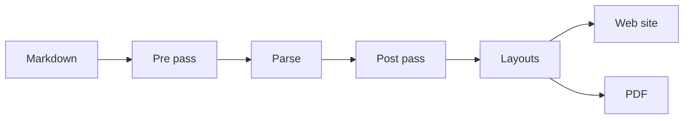

# Diagrams

A fenced block in a diagram language is drawn when the site is built and put in the page as
SVG. Nothing runs in the reader's browser, so a diagram looks the same on the web and in print.
Each language needs its module beside the plugin: `mermaid` or `plantuml`, added as a plugin
dependency the way `chromium` is.

## Mermaid



## PlantUML

The block is the diagram's source; the `@startuml` and `@enduml` lines are optional.

```plantuml
actor Author
participant Paperband
participant Chromium
Author -> Paperband : mvn generate-resources
Paperband -> Chromium : measure the pages
Chromium --> Paperband : what fits
Paperband --> Author : site and PDF
```

A diagram that can't be drawn stops the build with the drawing tool's own message, so a broken
diagram never reaches a reader.
