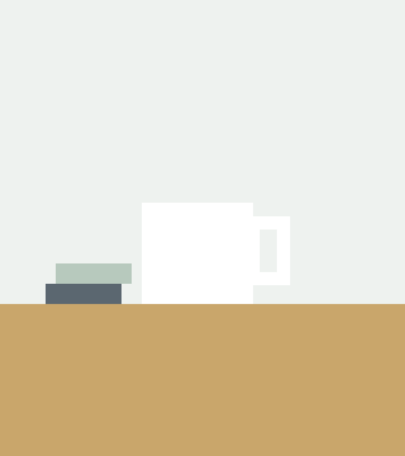

What a theme holds {! label}

# Three things, in one folder

1. A stylesheet that sets the colours and type
2. The fonts and images that stylesheet uses
3. Layouts every project using the theme gets

Forest theme · example deck {! footer}
